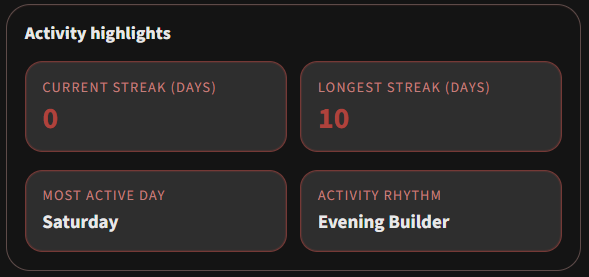
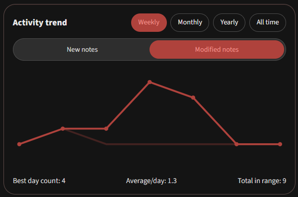
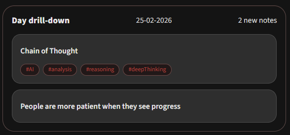

<h1 align="center">Obsidian Vault Activity</h1>

<p align="center">
  <a href="#"></a>
  <a href="#"></a>
  <a href="#"></a>
</p>

Vault Activity tracks streaks, trends, and click-through note lists to answer one useful question:

**"Am I actually revisiting and updating my notes, or just collecting them?"**

Vault Activity is an Obsidian plugin that tracks note creation and revision activity, then turns it into a dashboard you can scan in seconds.

## Why this plugin exists

The primary goal is to make note capture and maintenance visible. Vault Activity helps you answer whether you are revisiting and refining ideas over time by surfacing:

- Current and longest streaks tied to real note activity
- Most active weekday and rhythm summary to reveal your editing patterns
- Trend charts across weekly, monthly, yearly, and all-time windows
- Drill-down note lists behind each chart point to see which notes are behind the activity

> [!NOTE]
> If you follow Zettelkasten, it is easy to over-indulge on collecting fleeting notes and under-invest in linking and refining existing ideas. Vault Activity helps you keep both sides in balance so your system keeps compounding.



## Features

### 1) Dashboard widgets at a glance

- Streak stats and activity highlights
- Weekly, monthly, yearly, and all-time trends
- Metric toggle between **New notes** and **Modified notes**



### 2) Drill-down details

- Weekly and monthly: click a day to list matching notes
- Yearly and all-time: click a week or month to inspect grouped notes



### 3) Flexible configuration to suit your vault

- Tune conditions for streaks and summary stats
- Use your note metadata by configuring frontmatter keys for created and modified timestamps
- Set Include and Exclude folder filters to ensure you get the most relevant insights for your workflows

## Usage

### Commands

- `Open Vault Activity`
- `Refresh Vault Activity data`

### Obsidian settings

| Setting                   | What it does                                                   | Default            |
| ------------------------- | -------------------------------------------------------------- | ------------------ |
| Dashboard include folders | Optional allow-list scope for dashboard widgets and note lists | Empty              |
| Dashboard exclude folders | Exclude scope used when include list setting is empty          | `Templates`        |
| Streak calculation mode   | Choose what marks a day active                                 | `new-and-modified` |
| Created date property     | Frontmatter (property) key for new-note timestamps             | `Created`          |
| Modified date property    | Frontmatter (property) key for modified-note timestamps        | `Last modified`    |
| Date format               | Moment.js format of your frontmatter dates (e.g. `DD/MM/YYYY`) | Blank (automatic)  |
| Auto-refresh              | Recompute on create, modify, delete, and rename events         | `true`             |
| Refresh debounce (ms)     | Delay before recomputing after events                          | `400`              |

> [!TIP]
> For the most accurate modified-note activity, use Vault Activity alongside the [Update modified date](https://community.obsidian.md/plugins/frontmatter-modified-date) plugin. It keeps a modified timestamp in each note's frontmatter up to date as you edit. Set Vault Activity's **Modified date property** to the same key so the two plugins work together.

### Frontmatter date formats

Dates are read in this order, first match wins:

1. Your **Date format**, if set. Any [Moment.js format](https://momentjs.com/docs/#/parsing/string-format/) works, including `X` (Unix seconds) and `x` (milliseconds). Month names are read in Obsidian's language.
2. ISO 8601, such as `2024-01-15`, `2024-01-15T10:30` or `2024-01-15T10:30-05:00` (what Obsidian's date properties write).
3. Numeric dates such as `15/01/2024`, `15.01.2024` or `1-15-2024`. If both day-first and month-first readings are valid (`03/04/2024`), the date is ignored rather than guessed. Set **Date format** to resolve these.
4. English text dates such as `January 15, 2024`.

Dates keep the time they were written with. A time offset only identifies the timezone it was written in, so `2024-01-15T23:30-05:00` counts as 15 January at 23:30 wherever you open the vault. Invalid or ignored dates fall back to the file's own timestamps.

## Important behavior notes

> [!IMPORTANT]
> Obsidian only exposes a file's current modified time, so Vault Activity keeps its own edit history: each day it detects a body or link change to a note is recorded in the plugin's data. Property (frontmatter) changes alone do not count as edits.
>
> - History starts when you install (or upgrade to) a version with edit history. Earlier edits cannot be recovered: existing notes keep their creation date and start with one recorded edit at their modified date property, or none if it isn't set.
> - Several edits made while Obsidian is closed count as one edit, dated by the file's modified time.
> - Renames keep a note's history, including notes moved outside Obsidian (matched by identical content and an unchanged modified time, so a note restored by a tool that rewrites file times, such as a git checkout, starts with fresh history).
> - Folder filters only hide notes from the dashboard. History for notes outside the filters is kept, and edits made while a note is hidden count as one edit when it is shown again.
> - Deleting a note removes its history from plugin data permanently.
> - History is stored per device. If you sync plugin data between devices, each device records the edits it sees.

## Privacy

Vault Activity is local-first. 🔒

- No external analytics
- No remote data sync by this plugin
- Data is stored in Obsidian plugin storage for local snapshots and settings

## Development

### Scripts

```bash
npm run dev            # watch/dev build
npm run build          # production build
npm run lint           # eslint
npm run test           # vitest
npm run test:coverage  # vitest with coverage
npm run format         # prettier
```

### Tech stack & tools


###

## Roadmapped improvements

- [ ] Handle wider date format compatibility for frontmatter date fields
- [x] Improve determination of 'modified' notes (per-day edit history)
- [ ] Suggest inactive notes for review, updating or deletion

## Author

Built by **daniegee** with **GitHub Copilot**

If Vault Activity helps your writing cadence, drop a star and keep the streak alive. 📈
